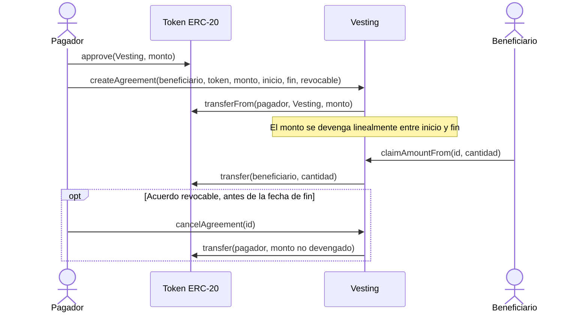

# Vesting de tokens ERC-20

Obligatorio de Taller de Tecnologías 2. Aplicación descentralizada para crear **acuerdos de vesting lineal**: una persona (el _pagador_) deposita tokens ERC-20 en un contrato, y otra (el _beneficiario_) los recibe gradualmente a lo largo de un período.

> **Demo:** [blockchain.lautaro.fyi](https://blockchain.lautaro.fyi), conectada a los contratos de Sepolia. Para probarla paso a paso, seguí [Probar en Sepolia](#probar-en-sepolia).

El repositorio es un monorepo con npm workspaces:

- `blockchain/`: el contrato `Vesting` en Solidity, sus tests y los módulos de despliegue (Hardhat 3 + Foundry).
- `web/`: la aplicación web (Vue 3 + Vite + Vuetify + wagmi/viem).

## Contenido

- [Funcionalidades](#funcionalidades)
- [Cómo funciona](#cómo-funciona)
- [Probar en Sepolia](#probar-en-sepolia)
- [Contratos desplegados](#contratos-desplegados)
- [Estructura del repositorio](#estructura-del-repositorio)
- [Anexo A — Desarrollo local con Hardhat](#anexo-a--desarrollo-local-con-hardhat)
- [Anexo B — Desplegar en Sepolia](#anexo-b--desplegar-en-sepolia)
- [Anexo C — Comandos y calidad](#anexo-c--comandos-y-calidad)

## Funcionalidades

- **Crear acuerdo**: elegir el beneficiario, el token, el monto y el período de liberación. Se hace en dos pasos: primero se aprueban los tokens y después se crea el acuerdo.
- **Mis acuerdos**: los acuerdos en los que sos pagador. Si un acuerdo es revocable, se puede cancelar antes de que termine.
- **Mis ingresos**: los acuerdos en los que sos beneficiario, con lo reclamado y lo disponible. Lo devengado se puede reclamar en cualquier momento.
- **Detalle del acuerdo**: el estado, el progreso de lo devengado y lo reclamado, y el historial de eventos on-chain.
- **Estados**: _Programado_ (todavía no empezó), _Activo_, _Finalizado_ (pasó la fecha de fin), _Completado_ (se reclamó todo) y _Cancelado_.

## Cómo funciona



Reglas del contrato (`blockchain/contracts/Vesting.sol`):

- **Devengo lineal**: antes del inicio no hay nada devengado. Entre el inicio y el fin se devenga `monto × tiempo transcurrido / duración`, y desde el fin está devengado el total.
- **Reclamar**: solo el beneficiario, y nunca más de `devengado − ya reclamado`. Cuando el acuerdo terminó y se reclamó todo, pasa a _Completado_.
- **Cancelar**: solo el pagador, solo si el acuerdo es revocable, está activo y no llegó a la fecha de fin. El pagador recupera lo no devengado. Lo devengado hasta ese momento queda reservado y el beneficiario lo puede seguir reclamando.

## Probar en Sepolia

Esta guía usa los contratos que ya están desplegados en la testnet Sepolia, así que no hace falta desplegar nada.

### 1. Requisitos

- [MetaMask](https://metamask.io/) u otra billetera inyectada en el navegador.
- Idealmente, **dos cuentas** en la billetera: una para el pagador y otra para el beneficiario.

### 2. Conseguir ETH de Sepolia

Las transacciones necesitan ETH de Sepolia para pagar el gas. Se consigue gratis en un faucet, por ejemplo:

- [Google Cloud Web3 Faucet](https://cloud.google.com/application/web3/faucet/ethereum/sepolia)
- [Alchemy Sepolia Faucet](https://www.alchemy.com/faucets/ethereum-sepolia)

Con unos `0.05 ETH` por cuenta alcanza para varias pruebas.

### 3. Conseguir tokens VDT

`VestingToken` (VDT) es un token de prueba cuya función `mint` es pública: cualquiera puede acuñar tokens para sí mismo.

1. Abrir el contrato en Etherscan: [VestingToken → Write Contract](https://sepolia.etherscan.io/address/0xCDD14DF34E299dF2BCC63AD42fe171F58e73b7ff#writeContract).
2. Hacer clic en **Connect to Web3** y conectar la cuenta del pagador.
3. Desplegar **mint** y completar:
   - `to`: la dirección del pagador.
   - `amount`: el monto en unidades mínimas (18 decimales). Por ejemplo, para **1000 VDT**: `1000000000000000000000`.
4. Hacer clic en **Write** y confirmar en la billetera.

Para ver el saldo en MetaMask, importar el token con la dirección `0xCDD14DF34E299dF2BCC63AD42fe171F58e73b7ff`.

### 4. Abrir la web

Abrir [blockchain.lautaro.fyi](https://blockchain.lautaro.fyi).

Para correrla localmente hace falta [Node.js](https://nodejs.org/) `^22.18.0` o `>=24.12.0` con npm 11 o superior. Desde la raíz del repositorio:

```sh
npm ci
npm run dev
```

y abrir `http://localhost:5173`.

La web usa RPCs públicos de Sepolia. Si alguno falla o limita los pedidos, se puede usar un RPC propio (Alchemy, Infura, etc.) creando el archivo `web/.env.local`:

```sh
VITE_SEPOLIA_RPC_URL=https://eth-sepolia.g.alchemy.com/v2/<tu-api-key>
```

### 5. Recorrido de prueba

1. **Conectar la billetera** con **Conectar billetera**, en la barra superior, y elegir la red **Sepolia**. La barra muestra la cuenta y la red activas.
2. **Crear un acuerdo** desde **Crear acuerdo**, con la cuenta del pagador:
   - **Dirección del beneficiario**: la segunda cuenta.
   - **Dirección del token ERC-20**: `0xCDD14DF34E299dF2BCC63AD42fe171F58e73b7ff`.
   - **Monto total de tokens**: por ejemplo `100`.
   - **Período de liberación**: elegir el día de hoy y activar **Personalizar horas de inicio y fin**, con un fin dentro de unos minutos. Así se ve el devengo avanzar.
   - Marcar **Acuerdo revocable** para poder probar la cancelación.
   - Hacer clic en **Aprobar tokens**, confirmar, y después en **Crear acuerdo** y confirmar.
3. **Ver el acuerdo** en **Mis acuerdos**, y abrir **Ver detalles** para ver el progreso y los eventos.
4. **Reclamar**: cambiar en la billetera a la cuenta del beneficiario, ir a **Mis ingresos** y usar **Reclamar**. El botón aparece cuando ya hay algo devengado. Con el botón de recarga de la tarjeta se actualiza el monto disponible.
5. **Cancelar**: con la cuenta del pagador, crear otro acuerdo revocable con un período más largo y cancelarlo desde **Mis acuerdos**. El pagador recupera lo no devengado, y el beneficiario puede seguir reclamando lo devengado hasta el momento de la cancelación.

### Problemas comunes

| Mensaje o síntoma                             | Qué hacer                                                                       |
| --------------------------------------------- | ------------------------------------------------------------------------------- |
| _La billetera está conectada a otra red_      | Cambiar a Sepolia en la billetera.                                              |
| _No tenés saldo suficiente para pagar el gas_ | Conseguir ETH de Sepolia en un faucet (paso 2).                                 |
| _El balance de tokens es insuficiente_        | Acuñar más VDT (paso 3).                                                        |
| El botón **Reclamar** no aparece              | Todavía no se devengó nada; esperar a la fecha de inicio y recargar la tarjeta. |
| El acuerdo nuevo tarda en aparecer            | Los eventos se sincronizan cada ~12 segundos (un bloque de Sepolia).            |

## Contratos desplegados

| Red             | Contrato             | Dirección                                                                                                                       |
| --------------- | -------------------- | ------------------------------------------------------------------------------------------------------------------------------- |
| Sepolia         | `Vesting`            | [`0x40b1f59fa038aD6Ec9c103A2F350CaE6F1670D18`](https://sepolia.etherscan.io/address/0x40b1f59fa038aD6Ec9c103A2F350CaE6F1670D18) |
| Sepolia         | `VestingToken` (VDT) | [`0xCDD14DF34E299dF2BCC63AD42fe171F58e73b7ff`](https://sepolia.etherscan.io/address/0xCDD14DF34E299dF2BCC63AD42fe171F58e73b7ff) |
| Hardhat (local) | `Vesting`            | `0x5FbDB2315678afecb367f032d93F642f64180aa3`                                                                                    |
| Hardhat (local) | `VestingToken` (VDT) | `0xe7f1725E7734CE288F8367e1Bb143E90bb3F0512`                                                                                    |

Los dos contratos de Sepolia están verificados en Etherscan. La web elige la dirección de `Vesting` según la red de la billetera, a partir de `web/src/config/contract-deployments.ts`.

## Estructura del repositorio

```text
blockchain/
  contracts/            Contratos: Vesting y VestingToken
  test/                 Tests de Solidity (*.t.sol)
  test/mocks/           Contratos auxiliares de los tests
  ignition/modules/     Módulos de despliegue de Hardhat Ignition
  ignition/deployments/ Direcciones desplegadas por red (Sepolia versionado)
  hardhat.config.ts     Compilador y redes
web/src/
  abis/                 ABIs de los contratos
  components/           Componentes por funcionalidad: layout/, wallet/, agreement/
  composables/          Lógica reactiva: lecturas, transacciones, eventos (useX.ts)
  config/               Direcciones por red y configuración de wagmi
  services/             Sincronización y persistencia de eventos
  views/                Pantallas de cada ruta
.github/                CI de pull requests y scripts de cobertura
```

## Anexo A — Desarrollo local con Hardhat

Para desarrollar sin depender de Sepolia se puede usar un nodo local de Hardhat.

1. Levantar el nodo y dejarlo corriendo en una terminal:

   ```sh
   npm run dev:blockchain
   ```

2. En otra terminal, desde `blockchain/`, desplegar primero `Vesting` y después `VestingToken`. El orden importa: así las direcciones coinciden con las de `contract-deployments.ts`.

   ```sh
   npx hardhat ignition deploy ignition/modules/Vesting.ts --network localhost
   npx hardhat ignition deploy ignition/modules/VestingToken.ts --network localhost
   ```

   `VestingToken` acuña 1.000.000 VDT para la primera cuenta del nodo. El monto se puede cambiar con el parámetro `initialMintAmount` del módulo.

3. Configurar MetaMask:
   - Agregar la red **Hardhat**: RPC `http://127.0.0.1:8545`, chain ID `31337`, moneda `ETH`.
   - Importar la cuenta `0xf39Fd6e51aad88F6F4ce6aB8827279cffFb92266` con su clave privada, que el nodo muestra al iniciar. Es una cuenta pública de prueba: **nunca usarla en redes reales**.

4. Levantar la web con `npm run dev` y elegir la red Hardhat en la billetera.

> [!TIP]
> Cada vez que se reinicia el nodo, la cadena empieza de cero. Si MetaMask muestra `nonce too low`, ir a **Settings > Advanced > Clear activity tab data** (en versiones anteriores, **Developer tools > Delete activity and nonce data**).

## Anexo B — Desplegar en Sepolia

La red `sepolia` de `hardhat.config.ts` lee tres variables con `configVariable`. Se pueden definir como variables de entorno o guardarlas cifradas en el keystore de Hardhat:

```sh
cd blockchain
npx hardhat keystore set SEPOLIA_RPC_URL
npx hardhat keystore set SEPOLIA_PRIVATE_KEY
npx hardhat keystore set ETHERSCAN_API_KEY
```

Desplegar y verificar en Etherscan:

```sh
npx hardhat ignition deploy ignition/modules/Vesting.ts --network sepolia --verify
npx hardhat ignition deploy ignition/modules/VestingToken.ts --network sepolia --verify
```

Ignition guarda las direcciones en `ignition/deployments/chain-11155111/deployed_addresses.json`. Después hay que actualizar `web/src/config/contract-deployments.ts` con la nueva dirección de `Vesting` y su **bloque de despliegue**. La web empieza a buscar eventos desde ese bloque, para no recorrer la cadena desde el bloque 0.

> [!WARNING]
> No expongas la clave privada mediante variables `VITE_*`: todo lo que empieza con `VITE_` termina en el bundle público de la web.

## Anexo C — Comandos y calidad

Todos los comandos se ejecutan desde la raíz. Siguen la convención `acción:ámbito`; sin ámbito, se ejecutan en ambos workspaces.

| Comando                            | Función                                                     |
| ---------------------------------- | ----------------------------------------------------------- |
| `npm run dev`                      | Inicia la web en `http://localhost:5173`                    |
| `npm run dev:blockchain`           | Inicia el nodo local de Hardhat                             |
| `npm run build`                    | Compila los contratos y construye la web                    |
| `npm run typecheck`                | Comprueba los tipos de ambos workspaces                     |
| `npm run test`                     | Ejecuta los tests de los contratos                          |
| `npm run test:coverage`            | Genera la cobertura y exige 100% de líneas por contrato     |
| `npm run lint`                     | Forge lint (Solidity), Oxlint y ESLint (web), sin modificar |
| `npm run lint:fix:web`             | Aplica las correcciones automáticas de la web               |
| `npm run lint:advisory:blockchain` | Muestra sugerencias informativas y de gas de Forge          |
| `npm run format`                   | Formatea el repositorio con Prettier                        |
| `npm run format:check`             | Comprueba el formato sin modificar archivos                 |
| `npm run preview:web`              | Sirve localmente el build de producción de la web           |

Para pasar argumentos a una tarea: `npm run test:solidity -- --coverage` o `npm run dev -- --host 127.0.0.1`.

El lint de Solidity requiere [Foundry](https://getfoundry.sh/) (`forge`). El CI usa Node.js 24 y Foundry v1.8.6.

**Integración continua**: los pull requests a `develop` y `main` comprueban el formato, la compilación y los tipos de ambos workspaces, el lint de Solidity y de la web (sin warnings), los tests y la cobertura del 100% de los contratos de producción.
